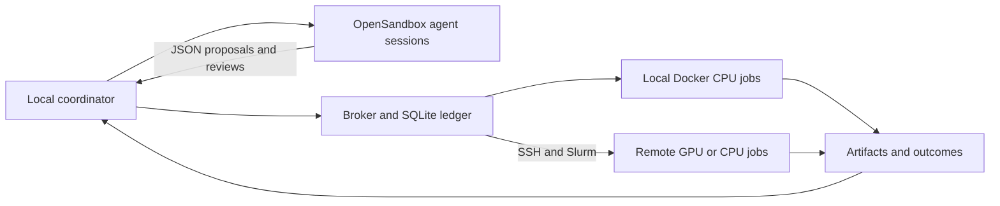

# Experiment orchestrator

A local control plane for experiments that run for hours or days on another machine. Sandboxed agents propose and review changes; a deterministic broker submits jobs, records their identity, collects evidence, and starts evaluation when results arrive.

**Open-Enricher stays independent and standalone.** A workload adapter integrates it without changing its repository. The same broker runs a CPU deduplication example and operator-configured command workloads.



## Quick start

Requirements: Linux/WSL, Python 3.11+ (a current patch release with tarfile extraction filters), Docker for isolated CPU workloads. OpenSandbox is needed only for agent sessions.

```bash
python -m venv .venv
source .venv/bin/activate
pip install -e .

experimentctl validate examples/experiments/cpu-exact.yaml
experimentctl submit examples/experiments/cpu-exact.yaml --request-id baseline-001
experimentctl watch <run-id>
experimentctl artifacts <run-id>
```

The CPU workload runs **on this Linux/WSL machine**, in a Docker container with no network, a read-only root filesystem and resource limits. It deduplicates texts and checks the expected count. It consumes no GPU and calls no model. The stopped container is retained; use `docker rm exp-<attempt-id>` after collection.

Without Docker, the explicit development profile starts a detached local process:

```bash
experimentctl submit examples/experiments/cpu-dev.yaml --request-id dev-001
```

`cpu-dev` accepts trusted workloads only: it provides separate directories, **not security isolation**. Stopping `watch` stops observation, not the job. Before installation, commands also work as `PYTHONPATH=src .venv/bin/python -m experiment_orchestrator ...`.

## Automatic deployment

The [deployment workflow](.github/workflows/deploy.yml) tests each push to `main`
and deploys it through a self-hosted GitHub Actions runner on the sandbox PC.
Each release has its own Python venv; activation preserves shared configuration,
SQLite state, credentials and running campaigns. Configure the runner label
`experiment-orchestrator` and the repository variable `ORCHESTRATOR_DEPLOY_ROOT`.
See [deployment setup and operation](docs/deployment.md). System dependencies and
the OpenSandbox server are provisioned manually.

## Monitoring dashboard

**Observatory** is a responsive, read-only dashboard for this orchestrator's
campaign agents and workloads across projects. It shows live agent output,
campaign progress, execution attempts, collected artifacts, metric comparisons
and resource history from the Ubuntu agent host. Remote GPU jobs remain separate
from local agent sessions.

Build the React Router and TypeScript frontend with Node.js 24, then serve it
through the Python FastAPI service on the agent host:

```bash
npm --prefix dashboard ci --include=dev
npm --prefix dashboard run build
.venv/bin/python -m pip install -e '.[dashboard]'
.venv/bin/experiment-dashboard --config orchestrator.yaml --local-no-auth
```

The command above enables loopback-only development access at
`http://127.0.0.1:8787`. Production access requires a private token; HTTPS and
Cloudflare Tunnel/Access setup are described in the
[dashboard guide](docs/dashboard.md). Existing runs appear immediately; agent
session telemetry is recorded by new invocations of the upgraded coordinator.

## Job operations

```bash
experimentctl list
experimentctl status <run-id> --refresh
experimentctl reconcile
experimentctl cancel <run-id>
experimentctl retry <run-id>
experimentctl events <run-id>
```

Reuse the same request ID after a lost submit response: it returns the same run. Changing the manifest with that key is an error. Intentional reruns use new keys; retries create separate attempts under the original run and consume its attempt budget.

Scheduler, pipeline, evaluation and artifact states are separate. An `unknown` submission never authorizes another launch. Preserve the state directory and remote attempt directories. SQLite belongs on a local filesystem, not NFS.

For an irrecoverable unknown state, [operator resolution](docs/architecture.md#submission-ambiguity) requires independently establishing that no original job remains active and recording that evidence. The automated coordinator never performs this override.

## Remote Slurm and Open-Enricher

1. Copy `examples/slurm-config.yaml` to `orchestrator.local.yaml` in this repository root.
2. Set your SSH alias, account/partition, shared remote job directory and Python runtime paths. The job directory must be visible to login and compute nodes.
3. Provision the workload dependencies on compute nodes. The broker ships a pinned source archive and its standard-library worker, not GPU dependencies.
4. Test the remote `cpu` profile first.
5. Set video filenames and the source commit in `examples/experiments/open-enricher.yaml`, then submit with the `gpu` profile.

```bash
experimentctl --config orchestrator.local.yaml submit examples/experiments/cpu-exact.yaml --request-id slurm-smoke-001
experimentctl --config orchestrator.local.yaml submit examples/experiments/open-enricher.yaml --request-id enricher-001
experimentctl --config orchestrator.local.yaml watch <run-id>
```

SSH uses existing host configuration and host-key verification. No SSH keys or scheduler access are forwarded to agents. The remote runtime needs its own native evaluator credentials. Inference and native evaluation currently share the same allocation.

Monitoring and collection run on the **local orchestrator PC**. The Slurm backend uses an OpenSSH persistent connection for staging, submission, status checks, cancellation and downloads. Each request opens a channel on that connection; polling every 30 seconds does **not** create a new network connection every 30 seconds. No resident monitoring service is installed on the cluster, and the cluster does not need inbound access to the PC.

OpenSSH retains the connection for one hour of inactivity by default. Regular checks keep it in use even for jobs lasting days. Keepalives detect an unresponsive peer; after a dropped or expired connection, a later request establishes a new one. A failed request is left for broker reconciliation rather than blindly replayed. Command deadlines and transfer deadlines are separate from the job's wall-time limit. Configure these settings in the profile's optional `ssh` mapping; see `examples/slurm-config.yaml`.

`watch` and `campaign run` accept `--poll-seconds` to change the check interval. This changes how often Slurm is queried, not the connection lifetime. If the local watcher stops, the job continues remotely; restart the watcher to resume checking and collection.

The Open-Enricher adapter archives the selected Git commit, modifies only that attempt's variant, invokes the standalone CLI with `--only`, `--video`, `--no-cache`, `--force`, and validates every requested video's native results and expected files. Source, outputs, caches, progress and archives are private to each attempt. Videos stay in the configured remote input directory. Slurm jobs run as your cluster user; a private directory is state isolation, not a security sandbox.

## Coordinated agents

Start OpenSandbox and configure provider credentials using [the harness guide](docs/agent-harness.md). A campaign supplies an objective, fixed rubric, baseline, four agent templates and a run budget.

```bash
experimentctl campaign create examples/campaigns/cpu.yaml
experimentctl campaign run <campaign-id>
experimentctl campaign status <campaign-id>
experimentctl campaign resume <campaign-id>
```

`campaign step` advances one step. The sequence is baseline → propose → review → submit → wait → evaluate → analyse. Additional candidates are bounded by `max_runs`, including the baseline. A rejected review ends the campaign.

Each role gets a fresh sandbox. The evaluator sees the rubric and baseline/candidate evidence without proposal/review transcripts; the analyst sees the hypothesis and earlier decisions. Responses are exported before teardown. GPU waiting invokes no agent. Saved prompts, task snapshots, responses and artifact references reconstruct context after restart; native Codex/Claude session restoration is not implemented.

Use `examples/campaigns/cpu-scripted.yaml` to test all four roles in real OpenSandbox sessions without model calls or credentials. The scripted roles are deterministic fixtures, not AI agents. `examples/campaigns/open-enricher.yaml` provides the 300-versus-600-second experiment template.

For Open-Enricher, replace the campaign baseline with the Open-Enricher manifest and select your `gpu` profile. Agents can change payload fields while the coordinator fixes source revision, execution profile, credentials, resource limits and input cohort.

## Other workloads

Register a trusted command and independent repository in operator configuration:

```yaml
repositories:
  my-workload: ../my-workload
workloads:
  sum:
    repository: my-workload
    argv: [python3, experiment.py]
```

Use a manifest with `adapter: command`, a configured profile, `source: {repository: my-workload, revision: <full-commit-sha>}` and `payload: {workload: sum, parameters: {values: [1, 2, 3]}}`.

The command reads parameters from `EXPERIMENT_INPUT`, writes evidence to `EXPERIMENT_OUTPUT` and a JSON outcome to `EXPERIMENT_RESULT`:

```json
{"pipeline":"succeeded","evaluation":"not_requested","metrics":{"sum":6}}
```

See `examples/command-workload/experiment.py`. Commands are trusted argv arrays; agents supply data, not shell fragments. Workload normalization belongs in `adapters.py`; execution belongs in `backends.py`.

## Development

```bash
PYTHONDONTWRITEBYTECODE=1 PYTHONPATH=src .venv/bin/python -m unittest discover -s tests
agent-harness validate
```

Tests cover real detached CPU/command workers, pinned source snapshots, cancellation, bounded retries, artifacts, campaign recovery and Slurm transport with fake scheduler executables and a lost SSH reply. They need no live LLM or cluster. The original harness CLI and examples remain available.

An optional loopback integration test exercises the real OpenSSH client against a temporary SSH server, with isolated test keys and host verification. It checks connection reuse across requests and broker-client instances, upload/download, command timeout, reconnection after a dropped connection, and idle expiry. To run it, install `asyncssh` in a test environment and run `EXPERIMENT_TEST_REAL_SSH=1 PYTHONPATH=src python -m unittest discover -s tests -p test_ssh_live.py`. The production package does not depend on `asyncssh`.

See [architecture and recovery](docs/architecture.md) for guarantees and deployment limits. The tool boundary currently consists of the CLI and Python broker operations. MCP, arbitrary agent-authored code patches, native session restore, automatic GPU environment provisioning and multi-host brokers are future extensions.
