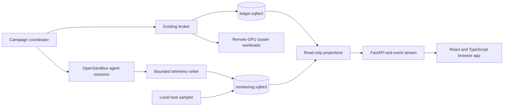

# Observatory dashboard

Observatory monitors the agents invoked by this experiment orchestrator. It runs
on the same Ubuntu host as the coordinator and is usable from desktop and mobile
browsers. Projects are grouped by the repository key in a run's source manifest,
with the adapter name used for built-in workloads. Open-Enricher is one project
among others; its application frontend is not a dashboard dependency.

The first version supports observation only. Opening a page never submits,
cancels, retries, reconciles, or resumes an experiment.

## What is available

| View | Information |
| --- | --- |
| Overview | Active agent sessions, active workloads, completed-run success rate, attention items, campaigns, host history |
| Campaigns | Objective, rubric, phase, baseline, candidates, iteration evidence, run budget |
| Agent sessions | Role, provider, project, sandbox, current command, timing, command failures, coordinator heartbeat, live output, prompt and validated response |
| Workloads | Local or remote execution, attempts, scheduler/pipeline/evaluation/artifact states, job ID, metrics and collected text artifacts |
| Compare runs | Parameters, source revisions, numeric metrics and differences across recorded runs |
| Agent host | CPU, memory, disk and dashboard process memory on the Ubuntu host |

Project filters, search, state filters and JSON exports make it possible to inspect
several experiments together. Selection and filters are represented in the URL.
Session output follows new events and can be paused for inspection. Comparison
differences are arithmetic, with no assumption that a larger value is better.

## Install and run

Build with Node.js 24 and install with Python 3.11 or later, from the repository
root. The browser build is copied into the Python package, so the running service
needs no Node server, external fonts, Redis or PostgreSQL.

```bash
npm --prefix dashboard ci --include=dev
npm --prefix dashboard run build
python3 -m venv .venv
.venv/bin/python -m pip install '.[dashboard]'

# Set a private token in the service environment. Keep it in your password manager.
export DASHBOARD_ACCESS_TOKEN="$(.venv/bin/python -c 'import secrets; print(secrets.token_urlsafe(32))')"
.venv/bin/experiment-dashboard --config orchestrator.local.yaml
```

Use the same config file as the campaigns you want to observe. The dashboard
reads its resolved `state_dir`. For the bundled CPU setup, use `orchestrator.yaml`
instead. The service listens on `127.0.0.1:8787` by default. Enter the token on the
sign-in screen. Sessions expire after 12 hours; restarting with a different token
invalidates existing sessions. The token is not placed in a URL or browser local
storage.

For local development only:

```bash
.venv/bin/experiment-dashboard --config orchestrator.yaml --local-no-auth
```

This flag requires a loopback bind and loopback clients. For LAN access, use
authenticated HTTPS through a reverse proxy, configure its hostname, and enable
secure cookies. The service reads dashboard settings from its process environment,
not the orchestrator's `.env` file.

| Setting | Default / purpose |
| --- | --- |
| `DASHBOARD_ACCESS_TOKEN` | Required outside explicit local development; at least 24 characters |
| `DASHBOARD_HOST` | `127.0.0.1` |
| `DASHBOARD_PORT` | `8787` |
| `DASHBOARD_ALLOWED_HOSTS` | `localhost,127.0.0.1,[::1]`; add the exact external hostname, without scheme or port |
| `DASHBOARD_SECURE_COOKIE` | Set `true` when the browser uses HTTPS |

## Production service on Ubuntu

The existing release installer now builds the frontend and installs the dashboard
extra. Follow [deployment setup](deployment.md) first. The example systemd user
unit in `examples/deployment/experiment-dashboard.service` assumes the deployment
root is `~/services/experiment-orchestrator`. Adjust both paths if yours differs.

```bash
mkdir -p ~/.config/systemd/user
install -m 644 examples/deployment/experiment-dashboard.service \
  ~/.config/systemd/user/experiment-dashboard.service
install -m 600 examples/deployment/dashboard.env.example \
  ~/services/experiment-orchestrator/shared/dashboard.env
# Edit dashboard.env and set a newly generated token before starting.
systemctl --user daemon-reload
systemctl --user enable --now experiment-dashboard.service
systemctl --user status experiment-dashboard.service
```

Have the host administrator enable user lingering if the service must run after
logout and start at boot. Logs are available with
`journalctl --user -u experiment-dashboard.service`. After activating a new
release, restart only the dashboard with
`systemctl --user restart experiment-dashboard.service` to load the new code and
assets. Existing campaign processes keep their original release. Start new
campaign invocations from the upgraded release to record agent sessions.

## Future Cloudflare access

Keep FastAPI on the Ubuntu machine. A named Cloudflare Tunnel can route the
dashboard hostname to `http://127.0.0.1:8787`. Place a Cloudflare Access application
and an explicit allow policy in front of that hostname, then add the hostname to
`DASHBOARD_ALLOWED_HOSTS` and set `DASHBOARD_SECURE_COOKIE=true`.

The application still requires its own access token. It does not authenticate a
request from a forwarded email or identity header. Tunnel and Access configuration
are separate deployment steps; this repository does not create a tunnel or publish
the dashboard. See Cloudflare's official [Tunnel documentation](https://developers.cloudflare.com/cloudflare-one/networks/connectors/cloudflare-tunnel/)
and [self-hosted Access application guide](https://developers.cloudflare.com/cloudflare-one/access-controls/applications/http-apps/self-hosted-public-app/).

Forward streaming responses without buffering. The browser reconnects automatically
and also polls the snapshot every 15 seconds when a connection is interrupted.

## Data model and boundaries



- `agent_harness.observation` provides an optional observer with no dashboard
  dependency. Observer failures are logged and do not change harness outcomes.
- `experiment_orchestrator.telemetry` records only coordinator-owned role
  invocations, using a separate SQLite WAL database and bounded writer queue.
  A session can exist before a workload has been submitted.
- `experiment_dashboard.reader` opens the experiment ledger with SQLite read-only
  mode. It never constructs a broker. Missing or stale evidence remains explicit.
- `experiment_dashboard.api` serves authenticated GET endpoints, a server-sent
  event stream, and the compiled frontend. Login and logout are the only POST
  operations.
- `dashboard/app` contains the React Router framework SPA, TanStack Query cache,
  typed data model, shared UI, detail views and responsive styles.

The cluster runs workloads only. Its recorded status and metrics come from the
existing broker. Keep `campaign run` or `experimentctl watch` running to update
that evidence; browser refresh does not query Slurm. The host chart describes the
Ubuntu agent machine, not remote GPU utilization.

For another project, register its repository and workload in orchestrator config
and keep the repository key stable. Numeric outcome metrics are flattened by name,
including nested dictionaries. No Open-Enricher-specific schema is required.

## Coverage and retention

- Historical campaign and workload records are readable immediately. Agent session
  telemetry starts with role invocations made by the upgraded coordinator; old
  harness reports are not imported automatically. Standalone harness invocations
  and unrelated machine processes are outside the monitoring scope.
- Heartbeats describe the coordinator's telemetry writer. After 20 seconds without
  one, a running session is marked **unobserved**, not failed. A workload without
  an observation for 120 seconds is marked stale. Neither implies a new job state.
- Each snapshot includes up to 500 records per category, with active work first.
  A notice appears when that limit is reached, and aggregate counts cover the
  displayed records. This version has no full-history pagination.
- Each session retains up to 10,000 events plus its final event and 2 MiB of
  redacted output. Oversized chunks and queue overflows are reported as incomplete
  telemetry. The viewer initially loads 200 recent events, resumes by durable
  cursor, and holds the latest 1,000 events in memory.
- Host measurements are taken about every 5 seconds, retained for 24 hours, and
  the last 240 samples are shown. Raw session events are retained for 14 days.
  Cleanup runs while the dashboard is running. Summaries remain until explicitly
  removed; SQLite may retain freed pages for reuse.
- Token usage, model cost and live remote GPU measurements are unavailable because
  the current harness and broker do not provide normalized observations for them.

Known runtime credentials and common credential fields are redacted before agent
telemetry storage and again in API projections. Artifact access is limited to
indexed regular files; symlinks, credential paths and traversal are rejected.
Only text previews are exposed, with a 256 KiB limit. Arbitrary sensitive research
content is not automatically classified or removed. Original harness reports and
broker artifacts retain their existing access controls and contents.

Back up the state directory with a SQLite-aware backup procedure. Losing
`monitoring.sqlite3` loses dashboard telemetry, but does not remove the broker's
experiment ledger. Run one dashboard service per state directory so host samples
are not duplicated. Keep SQLite on the Ubuntu host's local filesystem.

## Development and verification

```bash
.venv/bin/python -m pip install -e '.[dashboard,dashboard-test]'
npm --prefix dashboard ci --include=dev
npm --prefix dashboard run typecheck
npm --prefix dashboard run build
PYTHONPATH=src .venv/bin/python -m unittest discover -s tests -v

cd dashboard
npx playwright install --with-deps chromium
npm test
```

Browser tests start their own temporary workspace containing synthetic campaigns,
agent output and metrics. They do not start agents or cluster jobs. Desktop and
mobile checks cover sign-in, streamed state, session output, artifact previews,
comparison, project scoping and the read-only HTTP boundary.

For hot reload, run the API on port 8787 with `--local-no-auth`, then run
`npm --prefix dashboard run dev`. Vite proxies `/api` to the local service. Format
frontend changes with `npm --prefix dashboard run format`.

Future normalized usage metrics can extend the observer event schema. Additional
workload formats can extend read projections without changing the UI's metric
model. Any future experiment controls should use a separately authorized command
API through the broker, with explicit audit events, rather than extending the
dashboard's read-only reader.
